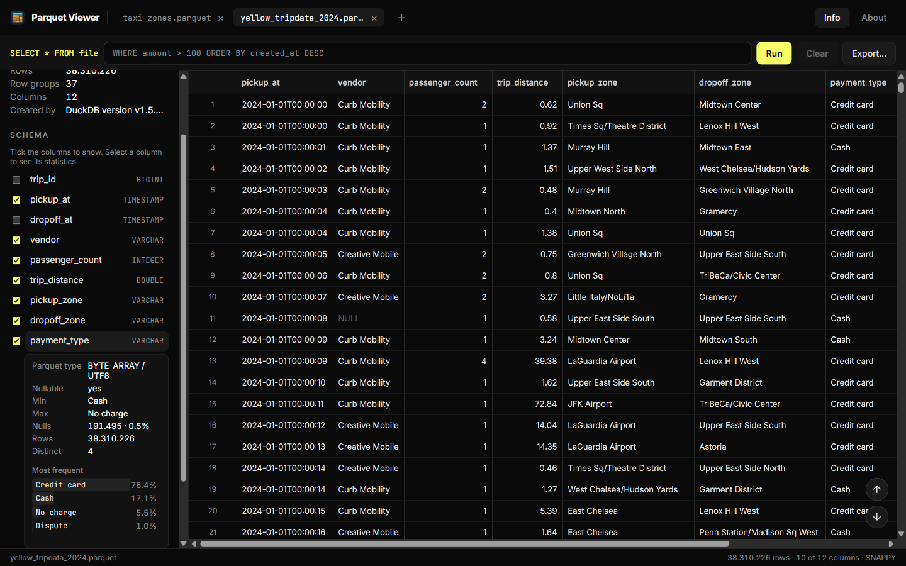
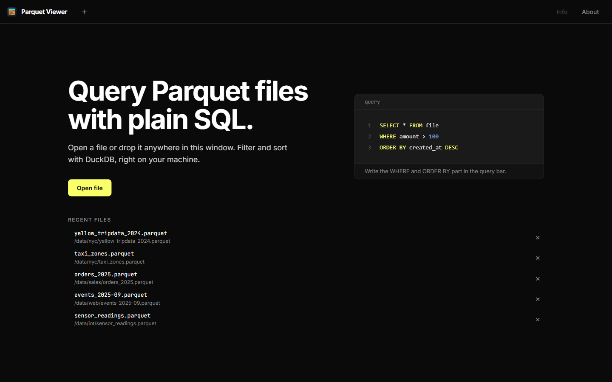
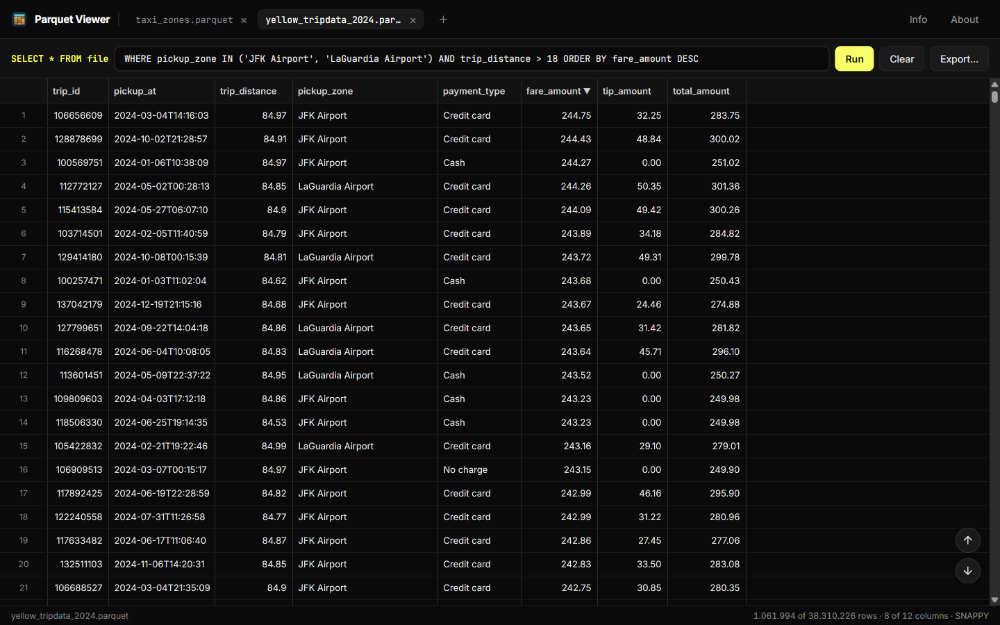

<div align="center">


# [Parquet Viewer](https://fabieu.github.io/parquet-viewer/)

[](https://github.com/fabieu/parquet-viewer/actions/workflows/ci.yml)
[](https://github.com/fabieu/parquet-viewer/releases)


A fast, read-only desktop app for opening Parquet files and exploring them with plain SQL.

[Website](https://fabieu.github.io/parquet-viewer/) • [Features](#features) • [Installation](#installation) • [Usage](#usage) • [Building from source](#building-from-source)



</div>

Parquet Viewer opens Parquet files of any size in an instant and lets you scroll, filter and sort them without importing anything. It reads only the rows you are looking at, so a file with 100 million rows feels as quick as one with a hundred. Everything runs locally on your machine, and files are never modified.

## Features

- **Open files any way you like:** from the file dialog, by drag and drop, from the command line, or by double-clicking a `.parquet` file.
- **Instant metadata:** see the file size, row count, row groups, writer and full schema as soon as the file opens.
- **Smooth scrolling through huge files:** the grid loads pages on demand and stays responsive at any depth, even in files with 100M+ rows.
- **Filter and sort with SQL:** type a `WHERE … ORDER BY …` clause and run it, with column and function names suggested as you type. Invalid queries show the exact error and keep the previous result on screen.
- **Sort by clicking headers:** each click cycles a column through ascending, descending and unsorted.
- **Column profiles:** min, max and null count from the file footer instantly; on demand, distinct count, most frequent values, mean, standard deviation and a histogram over the current filter.
- **Choose which columns to show:** hide and show columns from the schema list.
- **Copy cells and rows:** select a range and copy it to the clipboard.
- **Export the current view:** save the filtered and sorted rows, with the columns you are showing, as Parquet or CSV.

## Installation

Download the installer for your platform from the [latest release](https://github.com/fabieu/parquet-viewer/releases):

| Platform                        | Package                |
|---------------------------------|------------------------|
| Windows                         | `.msi` or `-setup.exe` |
| macOS (Apple Silicon and Intel) | `.dmg`                 |
| Linux                           | `.AppImage` or `.deb`  |

The installer registers Parquet Viewer as a viewer for `.parquet` files.

## Usage

### Opening a file

Click **Open file**, drop a file anywhere in the window, or pass the file's path as the first argument when launching the app. Files with the `.parquet`, `.parq` and `.pq` extensions are listed in the file dialog. The start screen lists the files you opened recently; click one to open it again.



### Exploring the file

The **Info** sidebar shows the file's metadata and schema. Select a column to see its Parquet type and footer statistics, or click **Load more** to scan it in the current view, and use the checkboxes to hide or show columns in the grid. Drag the sidebar's edge to resize it, or click **Info** to hide it.

The status bar at the bottom shows how many rows and columns are currently visible.

### Filtering and sorting

The query bar runs `SELECT * FROM file` followed by whatever you type. Write a `WHERE` clause, an `ORDER BY` clause, or both, then press <kbd>Enter</kbd> or click **Run**:

```sql
WHERE pickup_zone IN ('JFK Airport', 'LaGuardia Airport') AND trip_distance > 18
ORDER BY fare_amount DESC
```



As you type, the query bar suggests matching column and function names. Press <kbd>Tab</kbd> to insert the highlighted one, or pick one with the arrow keys and press <kbd>Enter</kbd>. <kbd>Ctrl</kbd>+<kbd>Space</kbd> lists every name.

Clicking a column header rewrites the `ORDER BY` part of the query for you. Right-click a cell to filter by its value: **Filter =** keeps the rows with that value, **Filter !=** removes them, and for numbers and dates **Filter ≥** and **Filter ≤** keep a range. On a `NULL` cell, the menu offers `IS NULL` and `IS NOT NULL` instead. Each choice adds a condition to the `WHERE` part. Click **Clear** to go back to the full file.

> [!TIP]
> The first query on a large file takes a few seconds while the result is prepared. After that, scrolling through the result is as fast as through the unfiltered file.

### Copying data

Select cells, rows or columns in the grid and press <kbd>Ctrl</kbd>+<kbd>C</kbd>, or right-click and choose **Copy**. The data is copied as tab-separated text, ready to paste into a spreadsheet. A single copy is limited to 10,000 rows.

### Exporting data

Click **Export…** in the query bar to save the current view to a new file. The export contains the rows that match your query, in its sort order, and only the columns you have not hidden. Choose a name ending in `.parquet` to keep the column types, or `.csv` for a comma-separated file with a header row.

Exporting has no row limit. The open file is never overwritten: choosing it as the export target shows an error.

## Building from source

You need [Rust](https://rustup.rs/), [Node.js](https://nodejs.org/) LTS, [pnpm](https://pnpm.io/installation) and the [platform prerequisites](https://v2.tauri.app/start/prerequisites/) for your operating system.

```sh
git clone https://github.com/fabieu/parquet-viewer.git
cd parquet-viewer
pnpm install
pnpm tauri dev     # run in development mode
pnpm tauri build   # build installers for your platform
```

> [!NOTE]
> The first build takes several minutes because the query engine is compiled from source. Later builds are cached.

To run the checks:

```sh
pnpm lint && pnpm format:check && pnpm test
cd packages/tauri && cargo fmt --check && cargo clippy --all-targets -- -D warnings && cargo test
```

The [project website](https://fabieu.github.io/parquet-viewer/) lives in `packages/website`:

```sh
pnpm --filter @parquet-viewer/website dev     # dev server at http://localhost:5173/parquet-viewer/
pnpm --filter @parquet-viewer/website build   # static build into packages/website/dist
```
